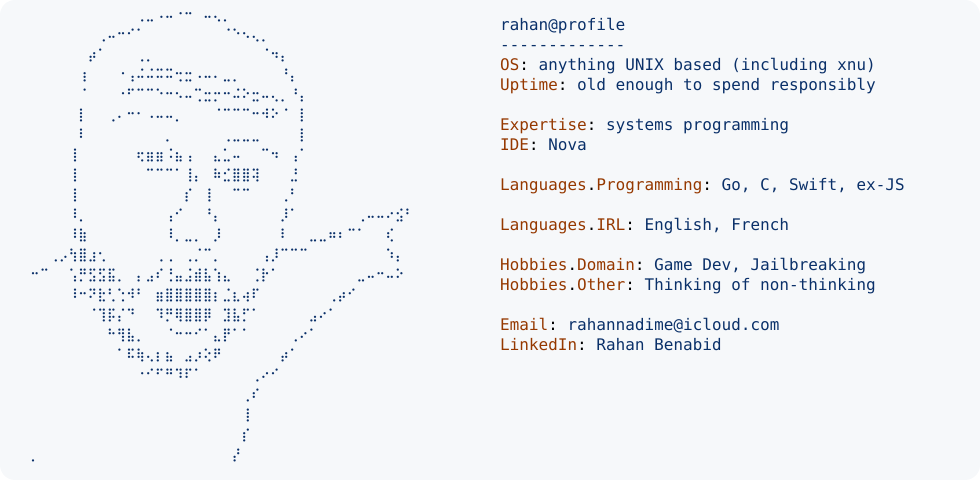

<h2 align="center">Greetings</h2>

###

<!--
  

    <table align="center" border="0">
      <tr>
        <td width="450">
          Name's Rahan.  
          Predominantly a <strong>Software Engineer</strong>
           
          Burned out in case you don't read GitHub profile status
            
          I like <code>system programming</code> and feeling close to the
          <i>OS</i>.
           
          I also enjoy <code>clean code</code> and <code>automation</code>.
            
          If my day hasn't fully drained me, I sacrifice some time for
          Game Dev or tinker with Console Jailbreaking...
          I swear it's a personality trait, not a phase   
          This Banner was <strong>not</strong> generated by AI. 
          If you want this README to be more helpful and read more naturally,
          just type your request below. Hold On... 
        </td>
      </tr>
    </table>
  

-->

<!-- @profile -->

  <a href="https://github.com/RahanBenabid/RahanBenabid">
    <picture>
      <source
        media="(prefers-color-scheme: dark)"
        srcset="
          https://raw.githubusercontent.com/RahanBenabid/RahanBenabid/main/dark_mode.svg
        "
      />
      
    </picture>
  </a>

###

<!-- language logos -->

  
  
  

 

###

<!-- spotify -->

  

<!-- le funny ref -->

  

###

<!-- stats -->

  
  
  

###

<!-- snek -->
<picture>
  <source
    media="(prefers-color-scheme: dark)"
    srcset="
      https://raw.githubusercontent.com/RahanBenabid/RahanBenabid/output/github-contribution-grid-snake-dark.svg
    "
  />
  <source
    media="(prefers-color-scheme: light)"
    srcset="
      https://raw.githubusercontent.com/RahanBenabid/RahanBenabid/output/github-contribution-grid-snake.svg
    "
  />
  
</picture>

